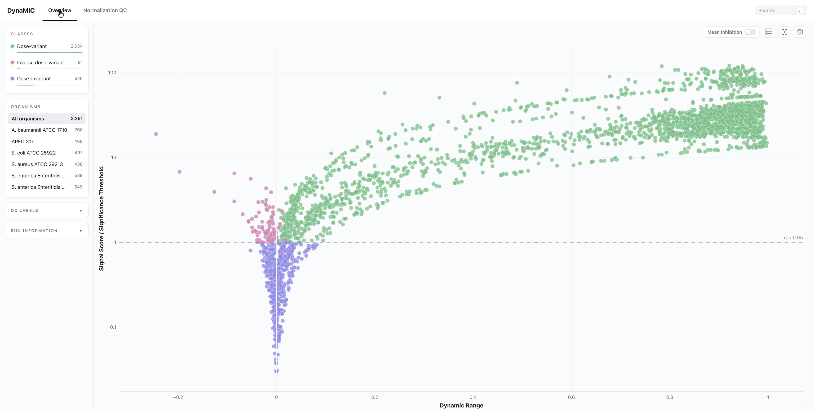

<p align="center">
  
</p>

# DynaMIC

Detection and modelling of dose-response signals in broth microdilution assays.

## Contents

1. [Description of DynaMIC](#description-of-dynamic)
2. [Interactive Report](#interactive-report)
3. [Dependencies](#dependencies)
4. [Installation](#installation)
5. [Input](#input)
6. [Commands](#commands)
7. [Output](#output)
8. [Credit](#credit)
9. [License](#license)

## Description of DynaMIC

DynaMIC normalizes optical density measurements using the growth and sterility controls from each
assay and uses these controls to construct organism- and dose-layout-specific empirical null
distributions. After multiple-testing correction, each dilution series is classified as
dose-variant, inverse dose-variant, or dose-invariant. Dose-variant series are modelled to estimate
the MIC, midpoint, and slope, with each parameter accompanied by a bootstrap confidence interval and
quality-control annotation. DynaMIC generates a self-contained interactive HTML report to support
the exploration and interpretation of the classification and modelling results.

## Interactive Report

DynaMIC provides an interactive report to facilitate data exploration. The report enables the user
to:

- Inspect treatment classification and estimated parameters
- Examine the statistical evidence behind each call
- Compare treatments within and across organisms
- Assess normalization and fit quality
- Export selected results and figures

<p align="center">
  
</p>

## Dependencies

- Python 3.12+
- [numpy](https://numpy.org) 1.26+
- [pandas](https://pandas.pydata.org) 2.2+
- [scipy](https://scipy.org) 1.15+
- [matplotlib](https://matplotlib.org) 3.9+
- [tqdm](https://tqdm.github.io) 4.66+

## Installation

### Installing from source

1. Clone the repository:

   ```bash
   git clone https://github.com/BirolLab/DynaMIC.git
   ```

2. Create and activate a conda environment:

   ```bash
   conda create -n dynamic python=3.12 -y
   conda activate dynamic
   ```

3. Install DynaMIC:

   ```bash
   cd DynaMIC
   pip install .
   ```

### Installation verification

DynaMIC ships with a synthetic dataset and its expected results. To confirm the installation
and reproducibility, run:

```bash
dynamic test
```

## Input

DynaMIC takes a single CSV, with one row per replicate dilution series. Every input file must
include the following columns:

| Column | Example | Description |
|---|---|---|
| assay_id | 1 | experimental batch |
| data_id | 8472 | unique row identifier |
| treatment_id | G1101352-74 | treatment identifier |
| treatment | Colistin | compound name, or a control |
| organism | Escherichia coli ATCC 25922 | bacterial isolate |
| A + concentration | A128 | optical density, one column per tested concentration |

**Important Notes:**

- DynaMIC requires each organism to have both "Growth Control" and "Sterility Control" treatment
  measurements.
- If an assay is missing one or both controls, control values are imputed by default from the
  organism-level control medians.

Refer to the example [input](dynamic/testdata/test_input.csv) file for the expected format.

## Commands

DynaMIC can be run end to end, or one stage at a time.

| Command | Description |
|---|---|
| run | runs all stages |
| normalize | converts optical density to inhibition fractions using the assay controls |
| calibrate | builds the organism- and layout-specific empirical nulls from the controls |
| classify | scores each dilution series against the nulls and assigns a dose-response class |
| model | fits logistic models to estimate MIC, midpoint and slope |
| report | builds an interactive HTML report from a completed run |
| test | verifies the installation against the bundled dataset |

### run

Runs normalize, calibrate, classify and model in sequence, then builds the report.

```bash
dynamic run --input <input>.csv --output-dir results/
```

| Option | Default | Description |
|---|---|---|
| --input | required | input CSV |
| --output-dir | dated directory | run directory, created as output/dynamic_results_ plus the date |
| --organism | all | restrict to one organism; repeat to select several |
| --calibration-dir | build a new one | reuse an existing calibration instead of building one |
| --missing-controls | impute | impute assay controls from organism medians, or exclude the assay |
| --within-assay-outlier-controls | exclude | keep or exclude control outliers within an assay |
| --across-assay-outlier-controls | report | report, impute or exclude assays whose controls are outliers |
| --n-null-curves | auto | simulated nulls per organism and layout |
| --q-threshold | 0.05 | false discovery rate for calling dose dependence |
| --min-slope / --max-slope | 0.01 / 30 | slope bounds for templates and fitting |
| --replicate-outlier-alpha | 0.05 | significance level for the replicate outlier test |
| --replicate-outliers | exclude | exclude or include detected replicate outliers, or skip outlier detection |
| --fit-label | dose-variant | class to fit: dose-variant, inverse dose-variant or dose-invariant |
| --fit-model | 2pl | 2PL fixes both plateaus, 3PL estimates the upper, 4PL estimates both |
| --mic-threshold | 0.95 | inhibition fraction defining the fitted MIC |
| --bootstrap | on | bootstrap confidence intervals for the fitted parameters |
| --n-bootstraps | 500 | maximum draws per curve |
| --max-workers | 30 | parallel workers |
| --plot | yes | write QC plots |
| --report | yes | build Report.html at the end |

### normalize

Converts optical density to inhibition fractions against each assay's growth and sterility controls,
and flags control outliers by modified Z-score.

```bash
dynamic normalize --input <input>.csv --output-dir results/normalization
```

| Option | Default | Description |
|---|---|---|
| --input | required | input CSV |
| --output | derived from the input | name of the normalized CSV, the input name with _with_if added |
| --output-dir | dated directory | stage directory, created as output/normalization_results_ plus the date |
| --organism | all | restrict to one organism; repeat to select several |
| --missing-controls | impute | impute assay controls from organism medians, or exclude the assay |
| --within-assay-outlier-controls | exclude | keep or exclude control outliers within an assay |
| --across-assay-outlier-controls | report | report, impute or exclude assays whose controls are outliers |
| --plot | enabled | disable with N, or give a path for the QC plot |

### calibrate

Simulates no-inhibition and full-inhibition dilution series from the controls and scores them
against a library of logistic templates, giving the empirical nulls and thresholds for each organism
and dose layout.

```bash
dynamic calibrate --normalized-data results/normalization/tables/<input>_with_if.csv \
                  --control-data results/normalization/tables/control_pool.csv \
                  --output-dir results/calibration
```

| Option | Default | Description |
|---|---|---|
| --normalized-data | required | normalized CSV from normalize |
| --control-data | required | control_pool.csv from normalize |
| --output-dir | dated directory | stage directory, created next to the normalized data |
| --organism | all | restrict to one organism; repeat to select several |
| --n-null-curves | auto | simulated nulls per organism and layout |
| --q-threshold | 0.05 | false discovery rate the null count is sized for |
| --min-slope / --max-slope | 0.01 / 30 | slope range spanned by the templates |
| --n-slopes | 9 | number of template slopes |
| --n-midpoints | 25 | number of template midpoints |
| --null-seed | 1 | random seed for null simulation |
| --plot | yes | write QC plots |

### classify

Scores each treatment-level curve against both empirical nulls, takes the larger of the two
null-specific *p*-values as the operational *p*-value, and adjusts it with the Benjamini-Hochberg
procedure within each organism and dose layout to assign the class.

```bash
dynamic classify --normalized-data results/normalization/tables/<input>_with_if.csv \
                 --calibration-dir results/calibration \
                 --output-dir results/classification
```

| Option | Default | Description |
|---|---|---|
| --normalized-data | required | normalized CSV from normalize |
| --calibration-dir | required | calibration directory |
| --output-dir | dated directory | stage directory, created next to the normalized data |
| --organism | all | restrict to one organism; repeat to select several |
| --q-threshold | 0.05 | false discovery rate for calling dose dependence |
| --replicate-outlier-alpha | 0.05 | significance level for the replicate outlier test |
| --replicate-outliers | exclude | exclude or include detected replicate outliers, or skip outlier detection |
| --replicate-max-outlier-fraction | 1/3 | most replicates that may be flagged per treatment |
| --minimum-replicates-for-outlier-test | 3 | replicates needed before the test runs |
| --max-workers | 30 | parallel workers |
| --plot | yes | write QC plots |

### model

Fits the dose-variant treatments to estimate minimum inhibitory concentration (MIC), midpoint and
slope, each with a bootstrap confidence interval and a quality-control flag.

```bash
dynamic model --normalized-data results/normalization/tables/<input>_with_if.csv \
              --classification-dir results/classification \
              --calibration-dir results/calibration \
              --output-dir results/modelling
```

| Option | Default | Description |
|---|---|---|
| --normalized-data | required | normalized CSV from normalize |
| --classification-dir | required | classification directory |
| --calibration-dir | required | calibration directory |
| --output-dir | dated directory | stage directory, created next to the normalized data |
| --organism | all | restrict to one organism; repeat to select several |
| --fit-label | dose-variant | class to fit: dose-variant, inverse dose-variant or dose-invariant |
| --fit-model | 2pl | 2PL fixes both plateaus, 3PL estimates the upper, 4PL estimates both |
| --min-slope / --max-slope | 0.01 / 30 | slope bounds for curve fitting |
| --mic-threshold | 0.95 | inhibition fraction defining the fitted MIC |
| --bootstrap | on | bootstrap confidence intervals for the fitted parameters |
| --n-bootstraps | 500 | maximum draws per curve |
| --max-workers | 30 | parallel workers |
| --fit-timeout-seconds | 900 | abandon a curve that exceeds this |

### report

Builds a self-contained interactive HTML report.

```bash
dynamic report --run-dir results/
```

| Option | Default | Description |
|---|---|---|
| --run-dir | required | completed run directory |
| --output | Report.html | report filename, or a path |

### test

Runs the bundled synthetic dataset and compares every class call, QC flag and fitted parameter
against the reference.

```bash
dynamic test
```

## Output

DynaMIC writes one run directory, with one subdirectory per stage:

| Path | Contents |
|---|---|
| normalization/ | inhibition fractions, control pool, QC plots |
| calibration/ | empirical nulls, logistic templates, thresholds |
| classification/ | per-treatment class calls with *p* and *q* values |
| modelling/ | fitted parameters, bootstrap draws, dynamic_results.csv |
| logs/ | run_log.txt, run_parameters.csv, run_parameters.json |
| Report.html | self-contained interactive report |

**Notes:**

- modelling/tables/dynamic_results.csv is the primary result table, with one row per well carrying
  the class call, fitted parameters, confidence bounds and QC flags.
- MIC and midpoint estimates outside the tested concentration range are flagged range-limited, and
  slopes steeper or shallower than the dilution spacing can resolve are flagged resolution-limited.

## Credit

Developed by [Ali Salehi](https://github.com/i-salehi)

## License

DynaMIC Copyright (c) 2026-present British Columbia Cancer Agency Branch. All rights reserved.

DynaMIC is released under the GNU General Public License v3 or later

This program is free software: you can redistribute it and/or modify it under the terms of the GNU
General Public License as published by the Free Software Foundation, either version 3 of the License,
or (at your option) any later version.

This program is distributed in the hope that it will be useful, but WITHOUT ANY WARRANTY; without
even the implied warranty of MERCHANTABILITY or FITNESS FOR A PARTICULAR PURPOSE. See the GNU General
Public License for more details.

You should have received a copy of the GNU General Public License along with this program. If not,
see http://www.gnu.org/licenses/.

For commercial licensing options, please contact Patrick Rebstein (prebstein@bccancer.bc.ca).

Refer to [licenses.txt](dynamic/assets/licenses.txt) for the bundled third-party assets and their
licenses.
